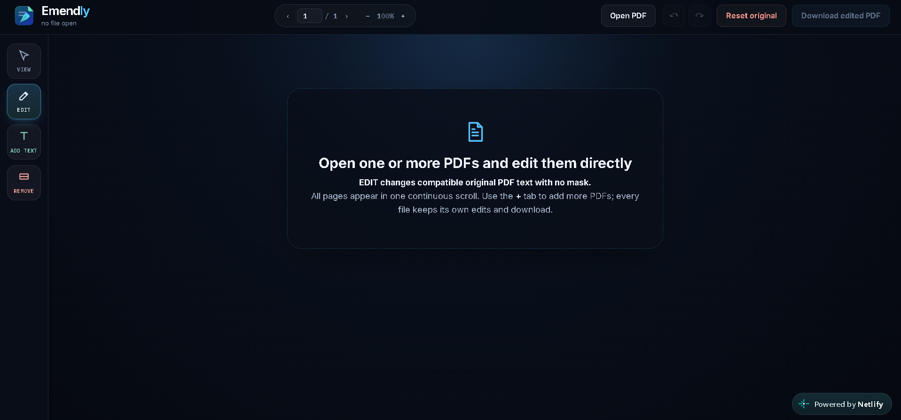

# Emendly

A browser-based PDF editor for making text changes directly in PDF documents, adding text, removing content, and downloading edited files.

## Screenshots

### Main Dashboard


**Live Demo:** https://emendly-pdf-editor.netlify.app

## Features

- **Open PDFs:** Select PDF files or drag and drop them into the editor.
- **Multiple Documents:** Work with multiple PDFs in separate tabs and download each document independently.
- **Continuous Page View:** View every page in a single scrollable workspace.
- **Edit Existing Text:** Select supported text in the PDF and edit it in place.
- **Add Text:** Place new text on a page and adjust its font, size, colour, and style.
- **Style Matching:** Match nearby text styling and use alignment guides and grid snapping.
- **Remove Content:** Select text or an area of a page to remove content.
- **Edit History:** Undo and redo changes, or restore the original PDF.
- **Download:** Export the edited document as a PDF.

## Built With

- HTML
- CSS
- JavaScript
- [PDF.js](https://mozilla.github.io/pdf.js/) – PDF rendering and text selection
- [pdf-lib](https://pdf-lib.js.org/) – PDF modification
- [fontkit](https://github.com/foliojs/fontkit) – Font embedding support

## Run Locally

1. Clone the repository:

   ```bash
   git clone https://github.com/2025ee42f-cmd/Emendly.git
   ```

2. Open the project folder:

   ```bash
   cd Emendly
   ```

3. Open `index.html` in a modern web browser.

**Note:** An internet connection is required to load the PDF libraries and font resources from public CDNs.

## Important Notes

- PDF editing is performed in the browser; this project does not include a server-side PDF processing backend.
- Editing results may depend on the structure and fonts used in the original PDF.
- Complex layouts, scanned documents, and unsupported text encodings may not behave like ordinary editable text.
- Keep an untouched
